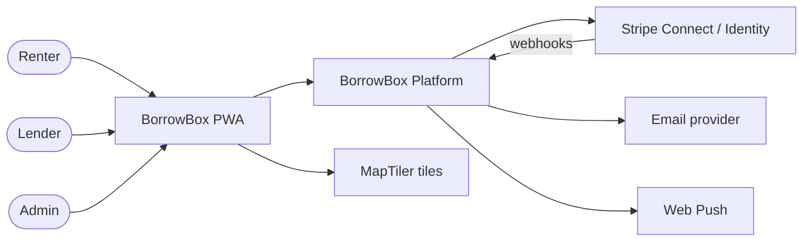
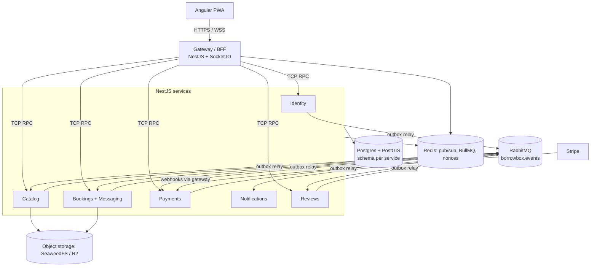
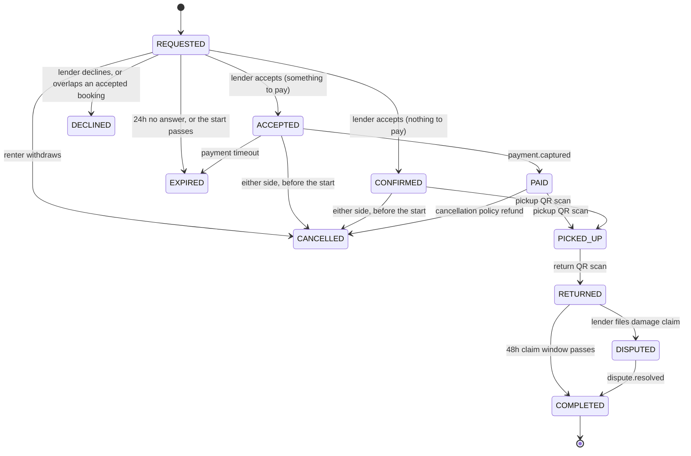

# BorrowBox – System Architecture

Target architecture. Decisions with trade-offs are ADRs in [`adr/`](adr); they hold the detail this file only summarises.

**Constraints:** one developer; portfolio/learning project that could become a product; launch in Greece/EU (GDPR, PSD2/SCA, DAC7). Microservices and events are deliberate; cost stays low with one monorepo, one Postgres and one `docker compose up`.

---

## 1. System context



## 2. Containers and communication



- Client → system only through the gateway (REST + Socket.IO).
- Gateway → service: NestJS TCP request/response ([ADR-0005](adr/0005-gateway-service-transport-tcp.md)), only for queries and user-initiated commands.
- Service → service: only events on topic exchange `borrowbox.events`, keys `<aggregate>.<event>.v<N>`. No synchronous calls in a business flow.
- Each service owns one Postgres schema and DB role; no cross-schema reads. Other services' data comes from local read models built from events.

## 3. Services

| Service | Owns | Publishes | Consumes |
|---|---|---|---|
| **Gateway** | nothing | – | Redis `chat:*` |
| **Identity** | users, credentials, refresh tokens, email tokens, verification, profile photos; its own security emails | `user.registered`, `.profile_updated`, `.email_verified`, `.verified`, `.deletion_requested` | – |
| **Catalog** | items, categories, photos, locations | `item.created`, `.updated`, `.deleted` | `user.registered`, `.profile_updated`, `.email_verified`, `.deletion_requested`; `booking.accepted`/`.confirmed` (featured); `review.created` |
| **Bookings** | bookings, availability, handoffs, condition photos | `booking.requested`, `.accepted`, `.confirmed`, `.paid`, `.declined`, `.expired`, `.cancelled`, `.picked_up`, `.returned`, `.completed`, `.disputed` | `item.*`, `user.registered`, `.profile_updated`, `.email_verified`, `.deletion_requested`, `payment.account_ready`/`.account_restricted`, `payment.captured` |
| **Payments** | connected accounts, payments, money movements, `stripe_events` | `payment.account_ready`, `.account_restricted`, `.captured`, `.failed`, `.refunded`, `.settled` | `user.email_verified`, `.deletion_requested`, `booking.accepted`, `.paid`, `.expired`, `.cancelled`, `.completed`, `.disputed`, `dispute.resolved` |
| **Messaging** (module of Bookings, [ADR-0017](adr/0017-in-app-chat.md)) | conversations, messages, offers, reports | `message.sent`, `conversation.unread`, `offer.sent`, `.withdrawn` | booking changes (in-process), `item.deleted`, `user.deletion_requested` |
| **Notifications** | recipients, email jobs (later: preferences, push, inbox) | – | `user.registered`, `.profile_updated`, `.deletion_requested`, `booking.*`, `payment.failed`, `.refunded`, `.settled`, `offer.sent`, `conversation.unread` |
| **Reviews** | reviews, trust scores | `review.created` | `booking.completed`, `.disputed`, `user.verified` |

**Media** (shared lib, [ADR-0009](adr/0009-photo-pipeline.md), [ADR-0013](adr/0013-wider-photo-formats.md)): presigned uploads to a private bucket; a BullMQ worker in the owning service (Catalog: item photos; Identity: profile photos, its own storage key) strips all metadata with `sharp` and writes resized copies to a public bucket. Only processed photos are served. JPEG/PNG/WebP/AVIF/GIF/TIFF (never SVG); the PWA re-encodes to JPEG (HEIC included). Under 320 px, unreadable or mislabelled → `FAILED`. Removing a photo, item or account deletes the row and queues its files in `photo_file_deletions` in one transaction; the worker also pre-registers files it's writing. A sweeper (10 min) re-queues interrupted photos, removes day-old abandoned uploads and retries deletions.

### Gateway
- REST under `/api`; typed clients per service extend one `ServiceClient`. Forwards the access token and `X-Request-Id`.
- Error mapping: each service's codes map to HTTP via a table typed against its contract (unmapped = compile error; at runtime → `500 INTERNAL`, logged). No answer → `503 SERVICE_UNAVAILABLE` (service named only in logs). Timeout `RPC_TIMEOUT_MS` 5 s; slow calls get longer timeouts derived in `libs/contracts` (Google sign-in 35 s, payout onboarding 46 s, dashboard 25.5 s). No automatic retries.
- Every error is `{ statusCode, code, message }`, never echoing the body. Malformed URL ids → `400 VALIDATION_FAILED`.
- Security: Helmet, CORS allow-list, 100 kB body limit, `class-validator` DTOs. Redis rate limits per IP: 10/min (login, register, Google, email links, password changes), 30/min refresh, 300/min suggest, 120/min otherwise; per-user limits on bookings (30/h), messages and offers (30/min), new conversations (20/day), payment/payout links (10/min). If Redis is down each instance counts in memory and switches back by itself. Over the limit, Google's browser routes redirect with `?error=RATE_LIMITED`.
- Cookies: refresh token only in `bb_refresh` (httpOnly, Secure, SameSite=Strict, `Path=/api/auth`), never in a body. Google sign-in state/nonce/PKCE in a signed 10-min `bb_oauth` cookie (SameSite=Lax).
- OpenAPI: `apps/gateway/openapi.json` is committed (`nx run gateway:openapi`; a test fails on drift); the PWA client is generated from it (`nx run web:api-client`).
- Live chat: Socket.IO namespace `/chat`, token in `auth.token`, Origin on the allow-list, one room per user, disconnected at token expiry. Every instance subscribes to Redis `chat:*` (also if Redis comes up later). Clients only listen; sending is REST.
- Endpoints (signed in unless marked public):
  - **Auth/account:** `POST /auth/register|login|refresh|logout`, `GET /auth/google` + `/google/callback`; public `POST /auth/verify-email`, `/password-reset` (always `202`), `/password-reset/confirm` (also clears the cookie); `GET|PATCH|DELETE /me`, `GET /me/export`, `POST /me/verification-email` (`202`), `/me/password`; profile photo `POST /me/photo` (upload link), `POST /me/photo/confirm`, `DELETE /me/photo`; `GET /health`.
  - **Catalog:** public `POST /items/search|suggest|featured|category-counts` (the point travels in the body, never in URLs or logs), `GET /items/:id`, `/items/:id/similar`; lender's `/me/items` (list, create, get, `PATCH`, `DELETE`, `PUT /:id/location`, `POST /:id/publish|pause|unpause`, photos: `POST /:id/photos`, `POST …/:photoId/confirm`, `DELETE …/:photoId`, `PUT /:id/photos/order`).
  - **Bookings:** public `GET /items/:id/quote?start=&end=`, `/items/:id/busy`; `POST /bookings` (client picks the id), `GET /bookings/:id`, `POST /bookings/:id/accept|decline|cancel`, `GET /me/bookings?role=&statuses=&cursor=`.
  - **Chat/offers:** `POST /items/:id/conversations`, `GET /me/conversations`, `/me/unread`, `GET /conversations/:id`, `GET|POST /conversations/:id/messages`, `POST /conversations/:id/read`, `/messages/:id/report`, `/conversations/:id/offers`, `/offers/:id/withdraw`, `/offers/:id/book`.
  - **Payments:** `GET /me/payouts`, `POST /me/payouts/onboarding|dashboard` (single-use Stripe links); renter `POST|GET /bookings/:id/payment`; Stripe-only `POST /webhooks/stripe` and `/webhooks/stripe-connect` (raw body + `Stripe-Signature` to Payments, no rate limit, not in OpenAPI).
  - `GET /me/export` has one section per service (identity, catalog, bookings, messaging, notifications, payments); any missing → `503`, never partial.
- Status codes: `400` `VALIDATION_FAILED`, `INVALID_PERIOD`, `TOKEN_INVALID`, `TOKEN_EXPIRED`, `INVALID_SIGNATURE`; `403` `EMAIL_NOT_VERIFIED`; `404` `NOT_FOUND`; `409` state/limit refusals (`INVALID_STATE`, `NOT_PUBLISHABLE`, `ITEM_LIMIT_REACHED`, `PHOTO_LIMIT_REACHED`, `PASSWORD_NOT_SET`, `SLOT_TAKEN`, `DUPLICATE_REQUEST`, `REQUEST_LIMIT_REACHED`, `OWN_ITEM`, `ITEM_UNAVAILABLE`, `CONVERSATION_CLOSED`, `OFFER_UNAVAILABLE`, `PRICE_ABOVE_LIST`, `PAYOUTS_NOT_SET_UP`, `PAYMENT_WINDOW_CLOSED`), told apart by `code`; `503` `PROVIDER_UNAVAILABLE` (Stripe didn't answer).

### Identity
- Passwords: 8–64 chars, ≥1 letter and digit (shared rule in `libs/contracts`); argon2id m=19 MiB, t=2, p=1, rehashed on login if parameters change; failures take the same work and error whatever the cause.
- Access token: Ed25519 JWT (`EdDSA`), 15 min, `iss aud sub jti sid` + `kid`; `sid` = refresh-token family. Only Identity holds the private key.
- Refresh token: opaque 256-bit, stored as SHA-256; rotates per use; family expires 30 days after sign-in. A revoked token, or one rotated ≥30 s ago, revokes the family; within 30 s a retry gets another token in the family.
- Google OIDC: code + PKCE + nonce (`openid-client`); matched on `sub`. A verified Google email auto-links to the account with that email; if that account was unverified, its password is cleared and sessions revoked (anti pre-hijacking). An email linked to another Google account is refused; unverified Google emails are rejected.
- Email links ([ADR-0016](adr/0016-notifications-and-email.md)): sent by Identity via `libs/mailer` after commit (failure only logged). 256-bit token only in the email and the link fragment `#t=`; stored as SHA-256 in `email_tokens`. Verification 24 h, reset 10 min, single use, newest replaces older; ≤1 email per kind per account per minute (extra requests succeed silently). Verifying (link, reset or Google) sets `email_verified_at` and emits `user.email_verified` once. Reset requests answer the same and take the same time whether or not the account exists; a reset signs out every session, gives Google-only accounts a password and sends a notice. Changing the password needs the current one, signs out other sessions and sends a notice.
- Profile photos ([ADR-0024](adr/0024-profile-photos.md)): public like the name; the media pipeline in Identity, centre-cropped to squares (96 and 512 px WebP, shorter side ≥128 px). A new upload waits (`PENDING`/`FAILED`) while the current photo stays, then replaces it in one transaction (old files queued for deletion). Every profile change, the photo's included, emits `user.profile_updated` with all current values; its optional `photo` (URLs or null) feeds Catalog's and Bookings' read models. Erasure removes the photo and its files.
- Lender ID verification via Stripe Identity above a deposit threshold (later).
- GDPR: export without hashes/tokens. `DELETE /me` needs the password, or for password-less accounts a sign-in <5 min old on a live session. One transaction anonymises the user, deletes OAuth identities and refresh tokens, removes the profile photo, redacts the stored `user.registered`/`.profile_updated` payloads and emits `user.deletion_requested`; every service then erases its own data (financial records kept as the law requires).

### Catalog
- `items.location` (private) and `location_public` are `geography(Point, 4326)`. Search: `ST_DWithin(location_public, point, radius)` (GiST) + Greek/English `tsvector` + category/price filters.
- Search is public; only `ACTIVE` items of known, non-deleted lenders; nearest first by the public point; opaque cursor (distance + id). A max price also matches free items ([ADR-0012](adr/0012-free-items-match-price-limits.md)). `beyond: true` lists what's past the radius, no upper limit, same filters ([ADR-0023](adr/0023-further-away-results.md)). The searcher's point and text are never stored or logged.
- Suggest: the 5 nearest items whose words all prefix-match (or share a Greek/English stem with) the typed text, from 2 chars. Category counts share the search's filter clause. Featured: up to 10 items in the radius, most booked in 90 days (from `booking.accepted`/`.confirmed`, one row per booking, pruned at 90 days), then newest. Similar: up to 8 other lenders' items, same category, within 10 km, most shared title words then nearest. People are never searchable by name.
- Location privacy ([ADR-0004](adr/0004-location-fuzzing.md), [ADR-0007](adr/0007-location-privacy-search.md), [ADR-0011](adr/0011-one-offset-per-place.md)): `location_public` = exact point + one stored random offset (150–300 m); a move under 300 m keeps it; a lender's items within 300 m share one offset. All public responses and searches use only `location_public`; radius ∈ {1, 2, 5, 10, 25, 50} km; distances shown as bands. The exact point is for its owner only, never renters (they arrange where to meet, [ADR-0015](adr/0015-booking-model.md)). Lenders drop a pin or use device location; nothing is geocoded ([ADR-0008](adr/0008-maps-pin-drop.md)).
- Pricing ([ADR-0010](adr/0010-flexible-pricing.md)): any of hourly/daily/weekly/monthly rates (€0.10–€1,000 each) or free, plus a deposit; optional min/max booking length in whole hours (1 h–90 days).
- Lifecycle: `DRAFT` → `ACTIVE` (needs verified email, location, a processed photo) ⇄ `PAUSED`; any → `DELETED` (tombstone without location/description). `item.created`/`.updated` carry a snapshot without location or description; `.updated` only when it changes. Client-picked ids; repeated commands succeed without a second event.
- Limits: 10 items per lender incl. drafts; creates and erasure share a per-lender lock. Lenders' names and profile photos kept from `user.*` (newest wins), verified lenders from `user.email_verified`; after `user.deletion_requested` that account's writes are refused (tokens live ≤15 min).

### Bookings
- Periods and prices ([ADR-0015](adr/0015-booking-model.md), [ADR-0020](adr/0020-booking-fees.md)): whole hours `[start, end)` as `tstzrange`, shown in Europe/Athens; 1 h–90 days (and the item's limits), starting 1 h–180 days ahead. Rent = cheapest combination of rates (day 24 h, week 7 d, month 30 d); rent, deposit, rate card and fees fixed at request.
- Double-booking is impossible at DB level (`btree_gist`, created by the infra init script):
  ```sql
  EXCLUDE USING gist (item_id WITH =, period WITH &&)
  WHERE (status IN ('ACCEPTED','CONFIRMED','PAID','PICKED_UP'))
  ```
- Every status change goes through one function that checks the state machine (§4) and writes the outbox event. Owns the QR handoff (§5).
- Read models: items (Catalog snapshots, newest wins, deletion final) and users (names, profile photos, verified emails). Backfill with `nx run catalog:republish-items` / `identity:republish-users`.
- Requests: verified renter, `ACTIVE` item not their own, client-picked id. ≤10 open requests per renter, no second overlapping request for the item, held periods refused (`SLOT_TAKEN`); serialised per renter.
- Answers: accept → `CONFIRMED` if rent and deposit are 0, else `ACCEPTED` (needs the lender's payouts ready, from `payment.account_ready`/`.account_restricted`, else `PAYOUTS_NOT_SET_UP`). Accepting declines overlapping requests (`OVERLAP`) in the same transaction; accepts serialised per item, the constraint turns races into `SLOT_TAKEN`. Renter withdraws a request; either side cancels `ACCEPTED`/`CONFIRMED`/`PAID` before the start (Payments refunds, [ADR-0021](adr/0021-refunds-and-settlement.md)).
- Expiry: a request after 24 h or at its start, whichever first; `ACCEPTED` unpaid by its pay-by time (24 h after acceptance or the start) → `EXPIRED` `PAYMENT_TIMEOUT`. `payment.captured` moves `ACCEPTED` → `PAID` (`booking.paid` + a chat line to arrange where to meet); a payment for a closed booking is left to Payments to refund. All timers are BullMQ delayed jobs that re-check under the row lock; a 10-min sweeper catches lost jobs.
- Public queries: a price quote, and an item's held periods (start/end only).
- Events (`booking.*.v1`) carry ids, item title, period, rent, deposit, fees, reason; never names, emails or locations.
- `item.deleted` / `user.deletion_requested` cancel open and paid bookings (`ITEM_DELETED`, `ACCOUNT_DELETED` with `erasedUserId`); finished bookings stay without the erased name. Pausing an item only stops new requests. Export: stored name, verification, all bookings on both sides.

### Payments
Stripe test mode only (a live key stops the service). [ADR-0003](adr/0003-stripe-separate-charges-transfers.md), [ADR-0019](adr/0019-payments-fees-and-policies.md)–[0022](adr/0022-standard-service-agreement.md); see §6.
- Onboarding: the first "Set up payouts" creates an Express account (country `GR`, `transfers` only, our user id as metadata, nothing personal) and returns an onboarding link back to `/settings/payouts`. Needs a verified email. The row is written first and its id is the idempotency key, so retries never create a second account; a refused creation drops the row so the next try uses a new key.
- Webhooks: stored by Stripe event id (type and object id only), processed by a worker that fetches current state from Stripe with backoff; events for unknown or erased accounts skipped; pruned after 30 days.
- Checkout: Payments tracks the bookings it charges from `booking.*` (a closed booking stays closed whatever the order). Starting to pay creates one card PaymentIntent per booking for rent + deposit + fee (`transfer_group = booking_<id>`, booking id as only metadata, row id as idempotency key); its client secret goes to the renter only and is never stored or logged. Not in the last 10 min before pay-by. Success → `payment.captured`; failure → `payment.failed` (retry allowed). A booking closing unpaid cancels its PaymentIntent; a late success is fully refunded.
- Refunds and settlement ([ADR-0021](adr/0021-refunds-and-settlement.md)): each refund/transfer is one `money_movements` row, planned in the transaction of the causing event (once per payment and purpose) and executed by the worker with the row id as idempotency key; a DB check keeps planned movements ≤ the charge. Cancellation and settlement rules: §6. Transfers use `source_transaction` and wait while the lender can't be paid (error log after 7 days) or a dispute is open. `payment.refunded` / `.settled` go out once a payment's movements went through; pending refunds followed by webhook, failures logged for a person.
- Erasure: `user.deletion_requested` closes the account (tokens refused) and the worker deletes the Stripe account until it succeeds (only "no such account" counts as gone; errors logged from the 10th try). Overlapping onboarding hands out no link. The row stays. A daily job lists connected accounts carrying our user id: saves ids we lost, deletes ones nobody owns; hand-made accounts are left alone.
- Stripe errors logged with class, code, status and request id, never the message. For user requests: unreachable → `PROVIDER_UNAVAILABLE`, refused → `INTERNAL`.
- Backfill: `nx run payments:republish-accounts`. Export: payout account, renter's payments and refunds, lender's payouts (no card data).
See §6 and [ADR-0019](adr/0019-payments-fees-and-policies.md). Stripe test mode only: a live key stops the service from starting.
- **Lender onboarding:** the first "Set up payouts" creates the lender's Express account (country `GR`, `transfers` only, our user id as metadata, nothing personal) and returns a link to Stripe's onboarding, which leads back to `/settings/payouts`. It needs a verified email (from `user.email_verified`). The row is written before Stripe is called and its id is Stripe's idempotency key, so retries never create a second account. If Stripe refuses to create the account, the row is dropped, so the next try isn't refused again under the same key.
- **Webhooks:** stored by Stripe's event id (type and object id only, never the payload) and processed by a worker that fetches the object's current state from Stripe, with retries and backoff. Events about accounts Payments doesn't know, or whose lender was erased, are skipped without asking Stripe. Processed events are pruned after 30 days.
- **Erasure:** `user.deletion_requested` closes the lender's account (their still-valid tokens are refused) and the worker deletes the Stripe account, retrying until it succeeds; only Stripe's "no such account" counts as already gone, and from the 10th failed attempt each failure is logged as an error. An onboarding call overlapping the erasure hands out no link. The row stays.
- **Stripe errors:** logged with the error's class, Stripe's code, the HTTP status and Stripe's request id, never Stripe's message (it can echo request data). For a user's request, Stripe unreachable is `PROVIDER_UNAVAILABLE` and Stripe refusing the call is `INTERNAL`.
- **GDPR:** the export has the payout account (Stripe account id, status, dates).
- **Checkout** ([ADR-0019](adr/0019-payments-fees-and-policies.md), [ADR-0020](adr/0020-booking-fees.md)): Payments keeps the bookings it takes money for from `booking.*` events (a closed booking stays closed, whatever order they arrive in). When the renter starts paying, it creates one card PaymentIntent per booking for rent + deposit + fee (charged at once, `transfer_group = booking_<id>`, only the booking id as metadata, our row's id as idempotency key) and returns its client secret to the renter only; it's never stored or logged. Paying can't start in the last 10 minutes before the pay-by time.
- **Outcome:** the PaymentIntent webhooks are processed like the others, from Stripe's current state: success writes `payment.captured`, a failed attempt `payment.failed` (the renter may try again). When a booking closes unpaid, the worker cancels its PaymentIntent; a payment that still succeeds for a closed booking is refunded in full.
- **Backfill:** `nx run payments:republish-accounts` re-announces the payable lenders for services started later (Bookings).
- **GDPR:** the export also lists the renter's payments and refunds, and the lender's payouts (amounts and dates, no card details).
- **Refunds and settlement** ([ADR-0021](adr/0021-refunds-and-settlement.md)): every refund and transfer is one `money_movements` row, planned in the same transaction as the booking event that causes it (once per payment and purpose) and carried out by the worker with the row's id as Stripe's idempotency key. A payment's planned refunds and transfers can never exceed its charge (a database check).
  - A cancelled paid booking: the renter more than 24 hours ahead gets all but the service fee back (never less than Stripe's cost kept); later, the deposit and half the rent, and the lender the other half minus their deposit fee; a lender's cancellation, a deleted item, a lender's erasure, or a payment that came after the booking closed, refunds everything. A renter's erasure counts as their cancellation (`erasedUserId` tells which side).
  - A completed booking: the lender gets the rent minus their deposit fee, transferred from the renter's charge (`source_transaction`), and the deposit goes back. A transfer waits while the lender can't be paid (an error log after 7 days); a disputed booking waits for the dispute's outcome.
  - `payment.refunded` (the renter's refund is on its way) and `payment.settled` go out once all of a payment's movements went through; refunds that are pending at first are followed by webhook, failures logged for a person to check.
- **Orphaned Stripe accounts:** once a day the worker lists the platform's connected accounts and, for those carrying our user id, saves an id Payments lost or deletes accounts nobody owns any more. Accounts made by hand are left alone.

### Messaging
A Bookings module with tables in `bookings` until its contracts settle ([ADR-0017](adr/0017-in-app-chat.md), [ADR-0018](adr/0018-price-offers.md)).
- One conversation per item and asker, opened by a verified user about an `ACTIVE` item not theirs (a request without one creates it); continues across their bookings of that item; read-only once the item is deleted or an account erased.
- Text 1–2000 chars (client-picked id), read state (unread counts, "seen"), system lines with codes for booking moments and withdrawn offers.
- Contact details (phone numbers ≥10 digits, emails, links, bare domains) are masked on read until the two have a booking that went ahead (`CONFIRMED`, `PAID` or later); senders see their own text.
- Live: after commit, each change is published per reader on Redis `chat:<userId>`; missed pushes are fetched on reconnect. 2 min after a message, if unread and not reminded in 30 min, `conversation.unread.v1` → Notifications emails a link. Events never carry message text.
- Offers: the lender offers a rent ≤ the rate card's (deposit unchanged) for a period; needs payouts if anything is paid; one open per conversation; valid 48 h or until 1 h before start; single use. Booking one creates and accepts the booking in one transaction (`offerId` on price and events).
- Retention/GDPR: conversations idle 2 years are deleted daily. Erasure blanks the person's messages ("[deleted]"), withdraws their open offers and deletes their reports. Export: conversations, own messages, offers, reports. Reports wait for the admin area.

### Notifications
[ADR-0016](adr/0016-notifications-and-email.md). Recipients (email, name, `el`/`en`) from `user.*` events, forgotten on deletion. Email over SMTP (`nodemailer`, Mailpit locally) from TypeScript templates in Greek and English, times in Europe/Athens.
- Emails: new request (lender); accepted (renter, with amount and pay-by; for an offer the lender is told); confirmed/paid (both: arrange where to meet); failed payment, refund on its way, declined (renter); deposit back and lender paid at settlement; expired (renter, and lender if unanswered or unpaid); cancelled (the other side; deleted item → renter); new offer (renter); unread messages. No welcome email.
- Sending: the consumer writes `email_jobs` with `processed_events`; a polling sender claims due jobs with a lease, renders in the recipient's language, retries with backoff up to a day. Jobs for unknown recipients wait; no SMTP host = never sent (retries); unrenderable jobs are dropped and logged. Erasure-caused cancellations wait 10 min so the erased person's copy is dropped. At least once. Sent jobs kept 30 days.
- Jobs store ids, item title, times and amounts, never names or message text. Export and erasure cover recipient and emails.

## 4. Booking lifecycle



Happy path: request → `booking.requested` (lender emailed) → accept → `booking.accepted` (Payments; renter emailed "pay by …") → renter pays (PaymentIntent, SCA) → webhook → `payment.captured` → `booking.paid` (arrange where to meet) → pickup QR → return QR → 48 h claim window (BullMQ) → `booking.completed` → transfer rent − lender's deposit fee, refund deposit → `payment.settled`.

**Reliability:**
- Transactional outbox: state change + event in one transaction to `<schema>.outbox`; a relay publishes (at least once), one relay per schema at a time (advisory lock) so order holds.
- Idempotent consumers: `event_id` in `<schema>.processed_events` in the same transaction as the side effect.
- Published outbox rows and `processed_events` are deleted after 7 days.
- Each queue: retry queue with TTL backoff (3 attempts) + DLQ.
- Envelope `{ eventId, type, version, occurredAt, correlationId, causationId, payload }`, types in `libs/contracts`.

## 5. QR handoff protocol
1. The showing party opens the handoff screen (lender at pickup, renter at return) and polls `GET /bookings/:id/handoff-token?phase=pickup` every 30 s: an Ed25519-signed `{ b, ph, n: nonce, exp: now+45s }`.
2. The other party scans it (`BarcodeDetector`, fallback `@zxing/browser`) and sends `POST /bookings/:id/handoff { token }`.
3. Bookings checks signature, `exp`, phase vs state, that the scanner is the counterparty, and the nonce (`SET NX` in Redis with TTL); then transitions and emits.
4. Both upload 1–3 condition photos (server timestamps, dispute evidence). Fallback: a 6-digit code derived from the token.

## 6. Payments (Stripe Connect, EU)
[ADR-0003](adr/0003-stripe-separate-charges-transfers.md), [ADR-0019](adr/0019-payments-fees-and-policies.md)–[0022](adr/0022-standard-service-agreement.md).
- Lenders are Express accounts (Stripe does KYC, IBAN payouts, SCA, DAC7). Ready = `transfers` capability active (`payment.account_ready`; losing it `.account_restricted`). Standard service agreement, `transfers` only; the platform carries losses on their accounts (small: they only receive transfers).
- Checkout: one PaymentIntent on the platform for rent + deposit + service fee, created when the renter starts paying. The fee always covers Stripe's cost ([ADR-0020](adr/0020-booking-fees.md)).
- Settlement on `booking.completed`: transfer rent − lender's deposit fee, refund the deposit. Damage claim: an admin decides; that part of the deposit goes to the lender, the rest back.
- Cancellation ([ADR-0021](adr/0021-refunds-and-settlement.md)): renter >24 h before start gets all but the service fee (Stripe's cost always kept); later, deposit + half the rent back, lender gets the other half minus their deposit fee; anything not the renter's doing (lender cancels, item deleted, lender erased, payment after close) refunds everything. A renter's erasure counts as their cancellation.
- Deposits are charged and refunded, not held (authorisations expire after ~7 days); the UX must say so.
- ⚠️ Before launch: confirm the flow of funds is covered by Stripe's licence (PSD2) and set up insurance/damage terms.

## 7. Frontend (Angular PWA)
- Standalone components, lazy feature routes, NgRx SignalStore per feature, API client generated from OpenAPI, Angular Material ([ADR-0006](adr/0006-ui-kit-angular-material.md)), Transloco Greek + English, EUR, `el-GR`.
- Shell: a top bar (navigation, avatar → Profile → Settings, Sign out; phones: ☰ drawer). Features plug in via `core/layout/nav-items.ts`. Explore (`/explore`) is public and the start page; signed-out visitors get Sign in / Create account and return where they were.
- Look: signed-in pages are flat and slightly rounded (6 px; cards 8, dialogs 12), content on the page background without panels; login/register softer. Colours only through CSS variables. Dark mode: the device's setting by default, a one-click sun/moon button in the top bar, "Follow my device" in Settings, kept in `localStorage` (`core/theme`); `main.ts` sets `data-theme` before Angular starts. Theme and language switches cross-fade (View Transitions; instant with reduced motion). Map tiles stay light.
- Explore: list or map (floating switch); filters (category, distance, price, free only) in the URL, the searcher's point in memory only; a featured carousel; category counts; side rails ≥1400 px. "Search this area" uses the smallest allowed radius covering the view. After the last page a "Further away" list ([ADR-0023](adr/0023-further-away-results.md)). Results, area and scroll survive visiting an item.
- Item page (`/items/:id`, public): photos, rates, deposit, lender, approximate area, similar items; a period picker (Athens time, held periods disabled) with the quote and "Request to book"; "Ask the lender". Owners get an edit link instead.
- Listing wizard (`/my-items/new`, `/:id/edit`): details → price → location (pin) → photos → publish; browser-picked id, draft created once priced; photos re-encoded to JPEG ≤2048 px, uploaded straight to storage, reorderable. My items (`/my-items`): status, next actions, "n of 10".
- Account: `/auth/verify-email`, `/auth/forgot-password` (resend after a 60 s countdown), `/auth/reset-password` (tokens read from `#t=` and removed from the URL); Settings: details, password, appearance, payouts, export, delete; a verify-email notice until verified. Profile (`/profile`): change or remove the photo (camera button on the avatar; the browser crops to the centred square and uploads a JPEG ≤1024 px straight to storage, then waits for processing). Avatars show the photo in the top bar, on item pages and in chat ([ADR-0024](adr/0024-profile-photos.md)).
- Bookings: `/bookings` (renting/lending tabs, current/past filter), `/bookings/:id` (status and reason, money by role, accept/decline/withdraw/cancel with the policy in words, pay-by countdown). Payments: `/bookings/:id/pay` (Stripe Payment Element, publishable `pk_test_` key from `/config.json`; 3-D Secure return params stripped from the URL and from login return URLs), `/settings/payouts` (status, onboarding, dashboard, `?stripe=return|refresh`).
- Messages: `/messages` and `/messages/:id` share one layout: opening a conversation slides the list into a left column (wide screens; phones one at a time). Live via Socket.IO (dev proxy `/socket.io`), red unread badges, masked-details hint, reports, offers in the thread.
- Session: access token in memory only (`AuthStore`); page loads restore via `POST /api/auth/refresh`. Refresh is single-flight per tab and serialised across tabs (Web Lock, `BroadcastChannel` for sign-in/out). The interceptor retries once after a refresh on `401 UNAUTHENTICATED`. Google sign-in is a full-page redirect back to `/auth/callback`; no token ever in a URL.
- Map: MapLibre GL + MapTiler, lazy; one `MapView` (`shared/map`) in browse, area and pin modes. Never a precise pin: Explore shows price tags (orange + area circle + small card on hover; clusters until zoom 17), the item page an area circle of radius `LOCATION_OFFSET_MAX_M` (300 m) ([ADR-0014](adr/0014-price-tags-on-explore-map.md)). Style URL from `/config.json` (maps say unavailable without it); place names follow the UI language; MapLibre's worker and CSS served from `/vendor/maplibre/`.
- Dev: `nx serve web` (4200) proxies `/api` and `/socket.io` to the gateway (3000), same-origin like Caddy in production.
- No fonts or icons from Google's CDN (GDPR). PWA: service worker, installable, offline shell, Web Push (VAPID); email is always the fallback (iOS push only for installed PWAs).
- Later features: `handoff` (QR, condition photos), `notifications`, `admin` (disputes).

## 8. Cross-cutting concerns

| Concern | Approach |
|---|---|
| AuthN/AuthZ | Gateway verifies JWTs; each service re-verifies with the public key. Resource-level checks live in the owning service. |
| Security | Helmet, CORS allow-list, Redis rate limits, `class-validator`, parameterised SQL only (lint rejects `${…}` in query text), EXIF stripping, signed URLs for private photos, secrets via env / Docker secrets. |
| Observability | pino JSON logs with `correlationId`, OpenTelemetry over HTTP and AMQP, Prometheus, Grafana + Loki + Tempo profile. |
| Testing | Jest units; Testcontainers integration (Postgres, RabbitMQ, Redis); shared contract types; Playwright e2e for the golden path in Stripe test mode. |
| CI/CD | GitHub Actions `nx affected -t lint test build`, images to GHCR, deploy on tag. |
| Deployment | One EU VPS with Docker Compose + Caddy (TLS; must forward `/socket.io` websockets). Postgres backups to R2. |
| GDPR | EU hosting, export and deletion flows, consent for non-essential cookies, DPAs, retention policy. |
| Admin | Minimal PWA area for disputes, reported listings, suspensions. |

## 9. Repository layout (Nx)

```
apps/     web, gateway, identity, catalog, bookings, payments, notifications (messaging, reviews later)
libs/     contracts (events, DTOs, RPC), auth, outbox, messaging (RabbitMQ), media, service-kit,
          mailer, observability, testing (Testcontainers)
infra/    docker-compose.yml (postgres+postgis, rabbitmq, redis, seaweedfs, mailpit),
          docker-compose.observability.yml, postgres/init (schemas + roles), storage (buckets, CORS)
docs/     ARCHITECTURE.md, adr/
```

## 10. Future work and side decisions
Future: Kafka/event log for analytics and replay; insurance for high-value items; Capacitor wrapper; Meilisearch if Postgres FTS isn't enough; neighbourhood groups and "wanted" requests.

Side decisions (revisit after all phases unless noted):
- **Rate limiting:** Redis uses a fixed window (≈2× burst at boundaries); the in-memory fallback a sliding log. Consider sliding window or token bucket (Lua).
- **Gateway retries/circuit breaker (Phase 7):** maybe retry read-only calls once, and/or fail fast while a service is down; never retry commands blindly.
- **Offsets from a secret (Phase 7):** pins moved ≥300 m and back draw new offsets, which could be averaged; derive them from a secret, the lender and a coarse area.
- **Stripe Connect costs (before launch):** per-payout and per-active-account fees, and lost fees on full refunds; a monthly lender fee or recovery from later transfers.
- **Payment record retention (before launch):** confirm the Greek period, add a setting and pruning.
- **CDN caching of public photos (Phase 7):** short cache lifetime or purge on delete (keys are random, never reused).
- **DLQs (Phase 7):** no alert, replay or expiry yet; add a depth alert, a replay command and a TTL matching outbox retention.
- **Registration reveals accounts:** `EMAIL_TAKEN`; answer as registered and email the owner, or accept behind the rate limit.
- **One signing key:** rotating signs everyone out; trust a list of keys by `kid`.
- **Open sockets after sign-out:** up to 15 min; publish revoked sessions on Redis to disconnect them.
- **Pruning indexes:** add partial indexes on outbox/processed_events timestamps if the tables grow.
- **Angular schematics** pinned a minor behind; align at the next update.
- **`S3_REGION` default (Phase 7):** Catalog and Identity default to `us-east-1` (SeaweedFS ignores it; R2 needs `auto`, data stays in the EU buckets). Drop the default so each environment sets it explicitly.
- **Redis password** on the command line locally; config file or secret in deployment (Phase 7).
- **Web bundle** 530 kB vs a 500 kB budget (the chat socket loads at start-up); load it lazily.
