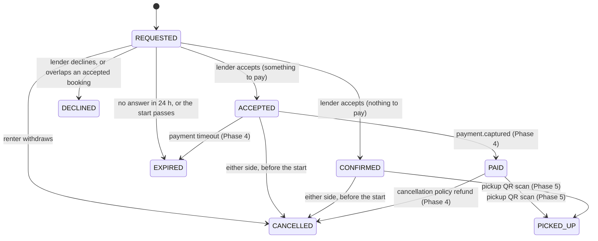

# ADR-0015: Booking model: periods, prices, states, and arranging the meeting

**Status:** Accepted. Supersedes the exact-location reveal of [ADR-0004](0004-location-fuzzing.md) and [ADR-0007](0007-location-privacy-search.md). Settles the Phase 3 consequences of [ADR-0010](0010-flexible-pricing.md) and amends the state machine in ARCHITECTURE.md §4.

## Context
Phase 3 builds Bookings. Several things were open before any code could be written:

- **What a booking period is.** Items can be priced by the hour, day, week or month ([ADR-0010](0010-flexible-pricing.md)), so a booking can't simply be a range of dates.
- **What a booking costs.** ADR-0010 says Bookings picks the cheapest combination of the offered rates, but not what a "day" or a "month" is, or when the price is fixed.
- **Bookings with nothing to pay.** A free item with no deposit can never get `payment.captured`, so the state machine had no way for it to go ahead.
- **Phase 3 has no payments.** Payments arrives in Phase 4, so paid bookings have no way past `ACCEPTED` yet.
- **Cancelling.** The state machine only allowed cancelling after `ACCEPTED`. A renter couldn't withdraw a request, and nothing said who may cancel.
- **Where to meet.** ADR-0004 and ADR-0007 reveal the item's exact point to a renter with a `PAID` booking. The exact point is usually the lender's home. Showing it to everyone who books, automatically, takes the choice away from the lender: they may prefer to meet at a café, a station or their work.

## Decision

### Periods
- A booking covers **whole hours**: `[start, end)` stored as a `tstzrange`. The PWA shows and picks times in **Europe/Athens** time; the service stores UTC instants.
- It lasts at least **1 hour**, starts at least **1 hour from now**, and starts at most **180 days ahead**. It lasts at most **90 days** (`BOOKING_MAX_HOURS`, set with Catalog's rental limits). The item's own minimum and maximum rental length (Catalog, Phase 3) narrow this further.

### Price
- Units: an hour, a **day = 24 hours**, a **week = 7 days**, a **month = 30 days**. Calendar months and daylight-saving changes don't change a price.
- The rent is the **cheapest combination of the offered units that covers the period**. It may cover more than the period when that's cheaper: 6 days at €5/day (€30) becomes 1 week at €25.
- The price, the deposit and the rate card used are **fixed when the booking is requested** and stored on it. Later changes to the item don't change existing bookings.
- A free item's rent is 0. It may still ask for a deposit.

### States

The later states (`RETURNED`, `COMPLETED`, `DISPUTED`) stay as in ARCHITECTURE.md §4.

- **`CONFIRMED`** is a booking with nothing to pay: rent 0 and deposit 0. It counts like `PAID` from then on. Whether a platform fee applies to free items is decided with Payments (Phase 4).
- **Until Phase 4**, a booking with something to pay stops at `ACCEPTED`. It keeps its slot, and the PWA says payment is coming soon. No payment timeout is scheduled until Payments exists.
- **No double booking:** the exclusion constraint covers `ACCEPTED`, `CONFIRMED`, `PAID` and `PICKED_UP`.
- **Overlapping requests:** accepting a request declines, in the same transaction, every other `REQUESTED` booking of that item whose period overlaps it (reason `OVERLAP`). Renters get an answer straight away instead of waiting for expiry.
- **Expiry:** a request with no answer expires after 24 hours, or at its start time if that is sooner.
- **Cancelling:** the renter can withdraw a `REQUESTED` booking. Either side can cancel an `ACCEPTED` or `CONFIRMED` booking before its start. Cancelling a `PAID` booking follows the refund policy (Phase 4).
- **Items and accounts:** pausing an item only stops new requests. Deleting an item, or erasing either person's account, cancels their open bookings (`REQUESTED`, `ACCEPTED`, `CONFIRMED`) through events.

### Where to meet: the exact location is never revealed
- No endpoint ever returns an item's exact point to anyone but its owner, whatever the booking state. Renters see the same approximate area as everyone else.
- Once a booking is `CONFIRMED` (or, from Phase 4, `PAID`), both people are asked to **arrange where and when to meet**:
  - a system message in the booking's conversation, with the booking's period, and
  - an email from Notifications.
- Until messaging is built (later in Phase 3), only the email is sent.

## Consequences
- The lender decides how much of their location to share, and with whom. The platform never gives out a home address. Catalog needs no access rules for the exact point: it stays owner-only, which is simpler and safer.
- Meeting arrangements happen in the conversation, so the messaging rules (contact details, limits, retention) matter more. They're decided with messaging.
- The handoff in Phase 5 doesn't depend on an address: the QR scan proves both people met with the item.
- Bookings stores a price snapshot per booking, so prices are reproducible for disputes and refunds. The pricing function needs thorough unit tests, including periods where a longer unit is cheaper.
- `CONFIRMED` is a new state that Payments, Notifications and the PWA must handle. Paid bookings stay at `ACCEPTED` in Phase 3, which is visible in the PWA until Phase 4.
- Auto-declining overlapping requests produces more `booking.declined` events. Each carries a reason, so notifications can explain it.
